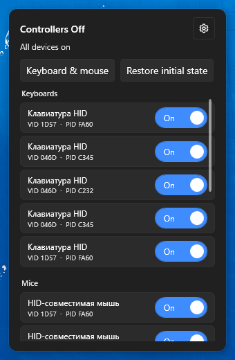

# Controllers-OFF

**Русский** · [English](README.en.md)

> Данное приложение было создано с целью облегчить себе жизнь при игре в **DaggerFall Online**. 
Когда к ПК подключен любой контроллер, который имеет при себе потенциометры, в **DFO** появляется фантомный курсор.
Такая проблема присутствует не только в браузерной версии, но и в десктопной. 
Мне надоело лезть под стол и отключать свой руль, поэтому я сделал данное приложение. 

## Скриншот



## Что умеет

- Живёт в трее: левый клик по иконке открывает компактную панель рядом с треем, повторный клик или Esc — закрывает.
- Список подключённых HID-устройств (рули, КПП, джойстики, геймпады, кастомные vendor-коллекции) сгруппирован по типу, у каждого свой тумблер вкл/выкл.
- «Клавиатура и мышь» — выключает всё, кроме устройств ввода. Кнопка неактивна, если выключать нечего.
- «Вернуть как было» — включает устройства, которые приложение выключило в текущей или прошлой сессии.
- ПКМ по иконке в трее: открыть панель, «Включить всё» (аварийное включение всего, что приложение когда-либо оставило выключенным), выход.
- Настройки: тема (системная/тёмная/светлая), автозагрузка, язык (RU/EN), выбор основной клавиатуры и мыши, если их несколько.
- Включение и выключение устройств требует прав администратора — приложение само запрашивает UAC.
- Выключенные устройства Windows перестаёт отдавать в перечисление, поэтому приложение помнит их и восстанавливает при выходе.

## Требования

- Windows 10/11 x64.
- Ничего доустанавливать не нужно: сборка self-contained, .NET внутри.

## Портативная версия

1. Распаковать архив.
2. Запустить `ControllersOff.exe` (~65 МБ, .NET не требуется). Установка не нужна, настройки хранятся в `%LOCALAPPDATA%\ControllersOff`.
3. Приложение стартует в трее. Чтобы оно поднималось вместе с системой — включить автозагрузку в настройках.

Диагностический лог пишется в `%LOCALAPPDATA%\ControllersOff\toggle.log`.

## Сборка из исходников

```
dotnet build ControllersOff.sln
dotnet test  ControllersOff.sln
dotnet publish src/ControllersOff/ControllersOff.csproj -p:PublishProfile=win-x64
```


